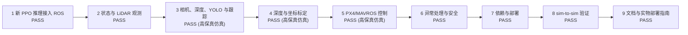

# NavRL 九项工作验收报告

`PASS` 表示已在对应环境实现并留有原始证据；`PASS (高保真仿真)` 表示在高保真仿真完成，不能等同于真机结论。当前没有无人机实物，因此真机验收明确标为 `N/A`，未被仿真结果替代或伪装。

| 工作 | 范围 | 状态 | 验收证据 | 实测结果或边界 |
|---:|---|---|---|---|
| 1 | 新 PPO 推理接入 ROS | `PASS` | checkpoint 前向与精确观测契约 | 276041 参数；Noetic CPU 前向 p50/p95 1.833/2.802 ms |
| 2 | 状态与 LiDAR 观测 | `PASS` | 离线形状及扰动接口校验 | state [1, 8]; LiDAR [1, 1, 36, 4]; dynamic [1, 1, 5, 10] |
| 3 | 相机、深度、YOLO 与跟踪 | `PASS (高保真仿真)` | Gazebo RGB-D、真实 YOLO、目标跟踪对真值；遮挡/雾/雨/逆光/组合挑战；空场景负对照 | r8 看门狗组合退化后 0.477 s 恢复，clean 后 142 次阳性检测；r8 位置/速度 p95 0.167 m/0.403 m/s；历史挑战集漏检率 18.99% |
| 4 | 深度与坐标标定 | `PASS (高保真仿真)` | CameraInfo、深度编码、TF 外参对 Gazebo 真值 | 内参最大误差 0.0000 px；32FC1；外参平移 [0.09, 0.0, 0.095] m |
| 5 | PX4/MAVROS 控制 | `PASS (高保真仿真)` | PX4 SITL + Gazebo Garden + MAVROS OFFBOARD 状态机 | OFFBOARD 200.80 ms；解锁 100.75 ms；高度 p95 误差 0.168 m |
| 6 | 异常处理与安全 | `PASS` | 超时保持、NaN 防护、急停、安全盾；控制和感知超时主动降级；LiDAR-only 退让 | 安全距离 0.3 m；视觉退化后 LiDAR-only 退让 63 条，首条 1.338 s；r8 看门狗恢复 0.477 s |
| 7 | 依赖与部署 | `PASS` | Noetic Docker 构建、Catkin 编译和部署脚本 | PyTorch 2.1.2+cu121；TensorDict/TorchRL 0.4.0 |
| 8 | sim-to-sim 验证 | `PASS` | 无头 Gazebo 干净组/压力组完整闭环；任务效率指标；20 分钟长时 | r5 策略调用 clean/stress 59/149；路径 1.622/1.374 m；路径平均速度 0.049/0.471 m/s；终点误差 2.678/0.985 m（各 1 次，非性能对照）；长时 1200 s/1200 样本；可视化 `task_metrics.svg` |
| 9 | 文档与实物部署指南 | `PASS` | 安装、参数、启动、排障、差距分析和实物门禁 | 已交付实物流程；真机执行状态为 N/A（无实物） |

## 计算开销与效率

| 指标 | 仅模型 CPU | 干净完整闭环 | 压力完整闭环 | 高保真视觉 | PX4/MAVROS SITL |
|---|---:|---:|---:|---:|---:|
| PPO 前向 p50 / p95 (ms) | 1.833 / 2.802 | 3.282 / 7.614 | 9.880 / 32.608 | N/A | N/A |
| 控制记录 / 策略调用 | N/A | 325 / 206 | 783 / 112 | N/A | N/A |
| 陈旧观测保持 / 控制超时 | N/A | 19.08% / 0.31% | 21.07% / 1.53% | N/A | N/A |
| 超周期主动降级保持率 | N/A | 0.00% | 60.03% | N/A | N/A |
| 进程 RSS p95 (MiB) | 440.477 | 457.948 | 458.375 | N/A | N/A |
| YOLO 前向 / 回调 p50/p95 (ms) | N/A | N/A | N/A | 12.870/21.325；15.648/24.646 | N/A |
| 高保真感知挑战（加权漏检率 / 组合报警率） | N/A | N/A | N/A | 18.99% / 100.00% | N/A |
| YOLO 空场景负对照：阳性帧 / 总检测帧 | N/A | N/A | N/A | 0 / 247（0.00%） | N/A |
| 目标水平位置 / 水平速度 p95 | N/A | N/A | N/A | 0.167 m / 0.403 m/s | N/A |
| MAVROS 服务 / setpoint p95 (ms) | N/A | N/A | N/A | N/A | OFFBOARD 200.80；ARM 100.75；间隔 50.13 |

| Gazebo 任务级指标（r5，单次短航线） | N/A | clean_sim | perturbed_sim |
|---|---:|---:|---:|
| 任务结果 | N/A | 未完成 | 成功 |
| 完成时间 (s) | N/A | N/A | 2.919 |
| 路径长度 (m) | N/A | 1.622 | 1.374 |
| 路径平均速度 (m/s) | N/A | 0.049 | 0.471 |
| 终点航点误差 (m) | N/A | 2.678 | 0.985 |

上述每组仅 1 次任务，受初始动力学状态影响，不能代替多 seed 任务级性能对照；它证明 Gazebo 已实际采集这些指标。

长时稳定性：1200 s、1200 个每秒采样、23,505 条控制记录；真实 YOLO 前向样本 283 个，p50/p95 为 26.47/32.60 ms；PPO p95 42.18 ms；控制超周期 0.094%；栈 RSS 2242.6 -> 2259.0 MiB（+16.3 MiB，峰值 2278.3 MiB）。仿真时钟压力触发主动降级保持 97.86%，未出现 watchdog 告警或进程退出。详见 `benchmark_results/long_run_20260828_r1/long_run_summary.json` 和 `long_run_stability.svg`。

压力配置刻意标为 `stress_example_not_calibrated`：5 cm LiDAR 噪声、5% LiDAR 丢帧、10 cm/10 cm/s 目标误差、10% 目标丢失、2 cm 状态噪声和两个控制周期的观测延迟。它是 sim-to-sim 鲁棒性压力测试，不是对真实精度的估计。

## 改进量化对照（原版 NavRL）

两份训练记录采用相同配置（1024 并行环境、80 个动态障碍、最大回合长度 2200、seed 0）。这组数据量化训练端改进，不把 ROS 控制日志当作任务成功率。

| 指标 | 原版 NavRL | 改进版 NavRL | 差值 |
|---|---:|---:|---:|
| 成功率 | 71.39% | 84.86% | +13.48 个百分点 |
| 碰撞率 | 25.98% | 11.04% | -14.94 个百分点（相对降低 57.58%） |
| 平均速度 | N/A | N/A | 历史摘要未记录 |
| 航点误差 | N/A | N/A | 历史摘要未记录 |

算法差异不是调速或安全阈值平移：原版使用基础动态障碍编码和标准 PPO critic；改进版启用 `current_geometry` 几何编码、4 步历史/8 步风险场辅助预测，以及带风险 embedding 的 cost critic + Lagrange 约束。奖励、观测维度、动作上限、场景规模和 seed 保持一致，详见 `NAVRL_ALGORITHM_DIFFERENCE_CN.md`。

Gazebo 闭环评估器已经实际输出平均速度和航点误差（见上方 r5 任务表）；训练端历史摘要没有这两个字段，因此原版/改进版离线对照仍保留 `N/A`，没有用 Gazebo 单次任务数值冒充训练集统计。完整说明和复现命令见 `NAVRL_BASELINE_COMPARISON_CN.md`。

## 仿真与真实差距结论

高保真仿真已经覆盖相机图像、浮点深度、相机内参、机体到相机外参、移动行人、YOLO、深度投影、目标速度估计，以及 PX4/Gazebo Garden/MAVROS 的解锁和 OFFBOARD 控制。然而仿真仍没有真实相机噪声、滚动快门、镜头畸变、无线网络抖动、震动、桨流、气动扰动、电池电压下降或 EKF 失配。

实物部署保留的门禁是：实测相机内外参与深度比例、时间同步、EKF/传感器融合误差表征、台架测试、系留测试和受监督飞行测试。没有上述实物数据时，不报告真机成功率、碰撞率、定位精度或飞行安全结论。

## 原始证据与复现入口

- `benchmark_results/acceptance_dashboard.svg`：九项工作的总验收可视化看板。

- `benchmark_results/hifi_perception_20260828_r8/hifi_perception_acceptance.json`：最新高保真 RGB-D、YOLO、跟踪和计算开销原始结果。
- `benchmark_results/hifi_perception_20260828_r8/hifi_perception_watchdog_recovery_revalidated.json`：视觉组合退化 -> clean 的看门狗自动恢复结果。
- `benchmark_results/perception_safety_20260828_r1/lidar_fallback_acceptance.json`：视觉失效后独立深度占据图 LiDAR 退让结果。
- `benchmark_results/sim_latest_20260828_r5/`：Gazebo 任务级路径、速度、航点误差及干净/压力闭环原始日志。
- `benchmark_results/long_run_20260828_r1/`：20 分钟 Gazebo + ROS + YOLO + PPO 长时原始日志、CSV 和 SVG。
- `ABLATION_AND_SIMULATION_EVIDENCE_CN.md`：四变体消融入口、Gazebo 任务指标和安全边界说明。
- `benchmark_results/hifi_perception_20260827_r7/hifi_perception_challenge_suite.json`：遮挡/雾/雨/逆光/组合感知挑战汇总（含漏检率和 watchdog 报警）。
- `benchmark_results/hifi_perception_20260827_r7/hifi_perception_negative_control.json`：同一相机/YOLO 链路的空场景负对照，用于估计无目标阳性帧率。
- `benchmark_results/hifi_perception_20260827_r7/hifi_calibration_acceptance.json`：相机内参、浮点深度编码和 TF 外参对 Gazebo 真值结果。
- `benchmark_results/hifi_px4_mavros/px4_mavros_sitl_acceptance.json`：PX4/Gazebo Garden/MAVROS OFFBOARD 原始结果。
- `benchmark_results/sim_latest_20260826_r2/sim_real_gap_summary.json`：干净组/压力组 JSONL、CSV 和汇总。
- `benchmark_results/navrl_baseline_comparison.json`、`NAVRL_BASELINE_COMPARISON_CN.md`：原版 NavRL 与改进版同配置量化对照。
- `benchmark_results/navrl_baseline_comparison.svg`：原版/改进版成功率与碰撞率可视化。
- `benchmark_results/sim_latest_20260828_r5/task_metrics.svg`：Gazebo 路径、速度和航点误差可视化。
- `docker/run_hifi_perception_acceptance.sh`、`tools/run_px4_mavros_sitl_acceptance.sh` 和 `docker/run_sim_acceptance.sh`：三个可复现验收入口。
- `SIM_REAL_GAP_ANALYSIS_CN.md`、`SIM_TO_REAL_BENCHMARK_PROTOCOL_CN.md`、`PHYSICAL_DEPLOYMENT_GUIDE_CN.md`：论文差距分析、实物测量协议和实物部署门禁。
