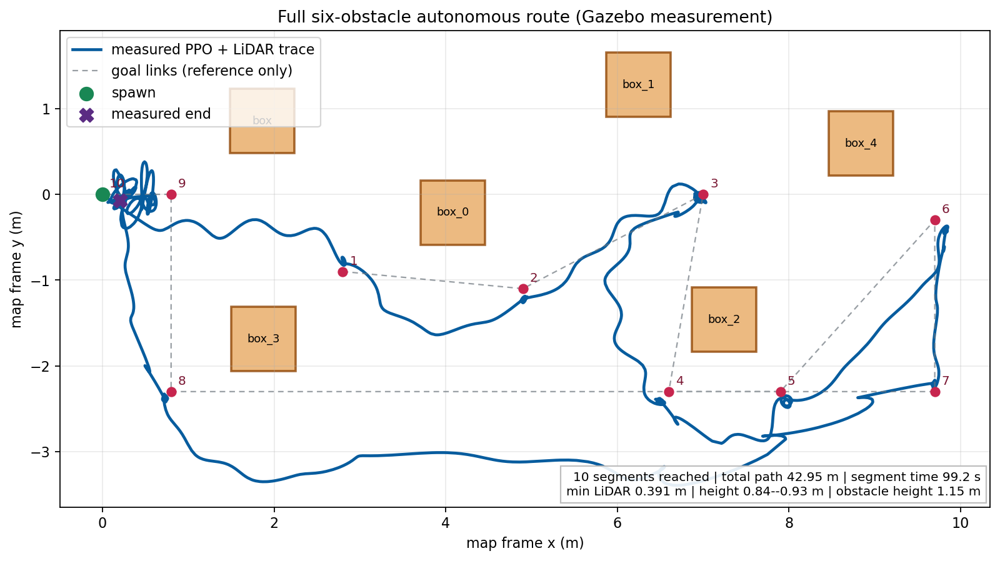
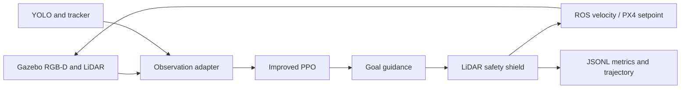

<div align="center">

# NavRL Code Improved

### Deployment-oriented safe navigation for UAVs in dynamic environments

[](https://wiki.ros.org/noetic)
[](https://gazebosim.org/)
[](https://pytorch.org/)
[](LICENSE)
[](ACCEPTANCE_REPORT_CN.md)

An improved NavRL implementation with a ROS1 deployment path, RGB-D/YOLO perception, LiDAR safety control, Gazebo evidence, and PX4/MAVROS SITL checks.

[Watch the full Gazebo run](benchmark_results/自主避障演示验收/六障碍物完整自主避障_Gazebo实录.mp4) ·
[Read the acceptance report](ACCEPTANCE_REPORT_CN.md) ·
[Read the sim-to-real analysis](SIM_REAL_GAP_ANALYSIS_CN.md)

</div>



> **Scope.** This repository is a simulation-first research and deployment package. The results below are Gazebo/PX4-SITL results. No physical UAV was available for this release, so the repository does not claim real-flight performance or safety validation.

## What this project adds

The project keeps the original NavRL observation and action contract while adding deployment-focused components:

| Layer | Implementation |
| --- | --- |
| Policy | PPO checkpoint with current obstacle geometry encoding, risk-history prediction, cost critic, and Lagrange constraint support |
| Observation | 8-D state, `36 x 4` LiDAR/raycast grid, goal direction, and `5 x 10` dynamic-obstacle slots |
| Perception | Gazebo RGB-D, floating-point depth projection, YOLO detections, target tracking, and velocity estimation |
| Safety | Fixed-shape checks, stale-data watchdog, NaN/Inf rejection, speed limits, LiDAR-only escape, and position-hold fallback |
| Control | ROS1 Noetic, Gazebo Classic, optional PX4/MAVROS topics, OFFBOARD/SITL acceptance scripts, and JSONL runtime metrics |

The deployment action is a bounded combination of the learned residual, goal guidance, and LiDAR tangential avoidance. The safety layer can override the policy action when the measured clearance or data freshness is unsafe.

## See it run

The included demonstration uses six static obstacles, six main goals, three return waypoints, and a final return to the spawn point. All ten goal segments were reached in the final video-synchronised run.

| Metric | Measured value |
| --- | ---: |
| Goal segments | 10 / 10 |
| Collision aborts | 0 |
| Total path | 42.949 m |
| Mission-window time | 99.233 s |
| Weighted mean speed | 0.433 m/s |
| Maximum waypoint error | 0.298 m |
| Minimum LiDAR clearance | 0.391 m |
| PPO latency (CPU, P50 / P95) | 20.826 / 57.645 ms |
| Control interval (P50 / P95) | 51.650 / 85.943 ms |
| Process RSS range | 456.64--458.95 MiB |

Raw records and the calculation method are in [`benchmark_results/自主避障演示验收/`](benchmark_results/自主避障演示验收/), especially [`低空自主避障六航点计算指标.json`](benchmark_results/自主避障演示验收/低空自主避障六航点计算指标.json) and [`计算开销与推理效率分析.md`](benchmark_results/自主避障演示验收/计算开销与推理效率分析.md).

## Quick start

### Requirements

- Ubuntu 20.04 is the reference host. Other Ubuntu versions can use the supplied Docker image.
- Docker with permission to run containers; NVIDIA Container Toolkit is optional for GPU inference.
- ROS1 Noetic and Python 3.8 are installed inside `docker/Dockerfile.noetic`.
- The included checkpoint is small enough to keep in the repository. Isaac Sim training still requires an external Isaac Sim installation and a suitable GPU.

### Build and check the ROS workspace

```bash
git clone git@github.com:yiwancibeishang123/NavRL-CodeImproved-Employment.git
cd NavRL-CodeImproved-Employment
bash docker/run_noetic_checks.sh
```

The check builds the Noetic image, compiles all four ROS packages, validates the checkpoint and calibration files, runs the PX4/MAVROS contract mock, and records a CPU policy benchmark.

### Run the repeatable headless benchmark

```bash
NAVRL_SIM_REPEATS=5 \
NAVRL_SIM_MISSION_SECONDS=6 \
bash docker/run_sim_acceptance.sh
```

Results are written to `benchmark_results/`. The perturbation profile is deliberately labelled `stress_example_not_calibrated`; it is a sim-to-sim stress test, not a fitted real-sensor model.

### Open the interactive obstacle demo

On a host with the Noetic Gazebo container prepared:

```bash
bash tools/运行低空自主避障演示.sh
```

The script starts the navigation node once, waits for odometry, publishes the complete route one goal at a time, and leaves the measured trajectory on `/rl_navigation/flight_trajectory`. Do not start a second Gazebo instance inside the same container.

## System layout



The ROS deployment path is intentionally separated from the Isaac training path:

```text
ros1/
  navigation_runner/    PPO adapter, observation contract, safety and metrics
  onboard_detector/     RGB-D, YOLO, tracking and calibration checks
  map_manager/          raycast/occupancy services and map configuration
  uav_simulator/        Gazebo vehicle, worlds and models
isaac-training/
  training/              PPO variants, environment and evaluation workers
  third_party/           pinned TorchRL and TensorDict sources
benchmark_results/       compact, selected acceptance evidence
tools/                   repeatable checks, reports and route utilities
```

## Documentation map

| Need | Start here |
| --- | --- |
| Install Ubuntu/ROS/Docker dependencies | [`UBUNTU_DEPLOYMENT_GUIDE_CN.md`](UBUNTU_DEPLOYMENT_GUIDE_CN.md) |
| Configure and launch ROS deployment | [`DEPLOYMENT_GUIDE_CN.md`](DEPLOYMENT_GUIDE_CN.md) |
| Understand the algorithm changes | [`NAVRL_ALGORITHM_DIFFERENCE_CN.md`](NAVRL_ALGORITHM_DIFFERENCE_CN.md) |
| Reproduce perception, calibration, and PX4 SITL checks | [`HIGH_FIDELITY_SIM_ACCEPTANCE_CN.md`](HIGH_FIDELITY_SIM_ACCEPTANCE_CN.md) |
| Analyse simulation versus physical deployment | [`SIM_REAL_GAP_ANALYSIS_CN.md`](SIM_REAL_GAP_ANALYSIS_CN.md) |
| Use the sim-to-real measurement protocol | [`SIM_TO_REAL_BENCHMARK_PROTOCOL_CN.md`](SIM_TO_REAL_BENCHMARK_PROTOCOL_CN.md) |
| Prepare a future Pixhawk/HIL or physical test | [`PHYSICAL_DEPLOYMENT_GUIDE_CN.md`](PHYSICAL_DEPLOYMENT_GUIDE_CN.md) |
| Review all nine work items and evidence | [`ACCEPTANCE_REPORT_CN.md`](ACCEPTANCE_REPORT_CN.md) |

## Reproducibility and evidence

Every acceptance result has a machine-readable artifact. The important groups are:

- `benchmark_results/自主避障演示验收/`: final six-obstacle route, route definition, raw control JSONL, resource metrics, trajectory figure, and video.
- `benchmark_results/hifi_perception_20260827_r7/` and `hifi_perception_20260828_r8/`: occlusion, fog, rain, backlight, combined degradation, watchdog recovery, and tracking errors.
- `benchmark_results/hifi_px4_mavros/`: PX4 v1.15 + Gazebo Garden + MAVROS OFFBOARD/SITL acceptance.
- `benchmark_results/sim_latest_20260826_r2/` and `sim_latest_20260828_r5/`: clean and perturbed closed-loop sim-to-sim logs.
- `benchmark_results/long_run_20260828_r1/`: 20-minute resource and timing monitor output.

The raw JSONL records environment versions, observation age, inference time, control time, control interval, safety interventions, memory snapshots, mission completion, path length, speed, waypoint error, and LiDAR clearance. The summary documents explain exactly which window is included in each statistic.

## Current boundaries

This release does not include a physical UAV or Pixhawk HIL run. Gazebo does not reproduce every real-world effect, including propeller aerodynamics, wind, vibration, rolling shutter, wireless jitter, battery sag, sensor calibration drift, or PX4 EKF failures. Before a real flight, use the physical deployment guide and complete camera/depth calibration, `T_body_camera` verification, estimator health checks, OFFBOARD/failsafe tests, tethered tests, and supervised flight tests.

## Contributing

Issues and pull requests are welcome. Please include the host/ROS/PyTorch versions, the launch command, the checkpoint hash, and the relevant JSONL excerpt when reporting a reproducibility problem. Never commit private flight logs, credentials, or unredacted camera data.

## Citation

This project builds on NavRL:

```bibtex
@ARTICLE{NavRL,
  author={Xu, Zhefan and Han, Xinming and Shen, Haoyu and Jin, Hanyu and Shimada, Kenji},
  journal={IEEE Robotics and Automation Letters},
  title={NavRL: Learning Safe Flight in Dynamic Environments},
  year={2025},
  volume={10},
  number={4},
  pages={3668-3675},
  doi={10.1109/LRA.2025.3546069}
}
```

Please also cite the original [NavRL repository](https://github.com/Zhefan-Xu/NavRL) when using the training environment or its upstream implementation.

## License

Released under the [MIT License](LICENSE). Please review the licenses of the vendored TorchRL/TensorDict sources and any simulator assets before redistributing a derivative package.
